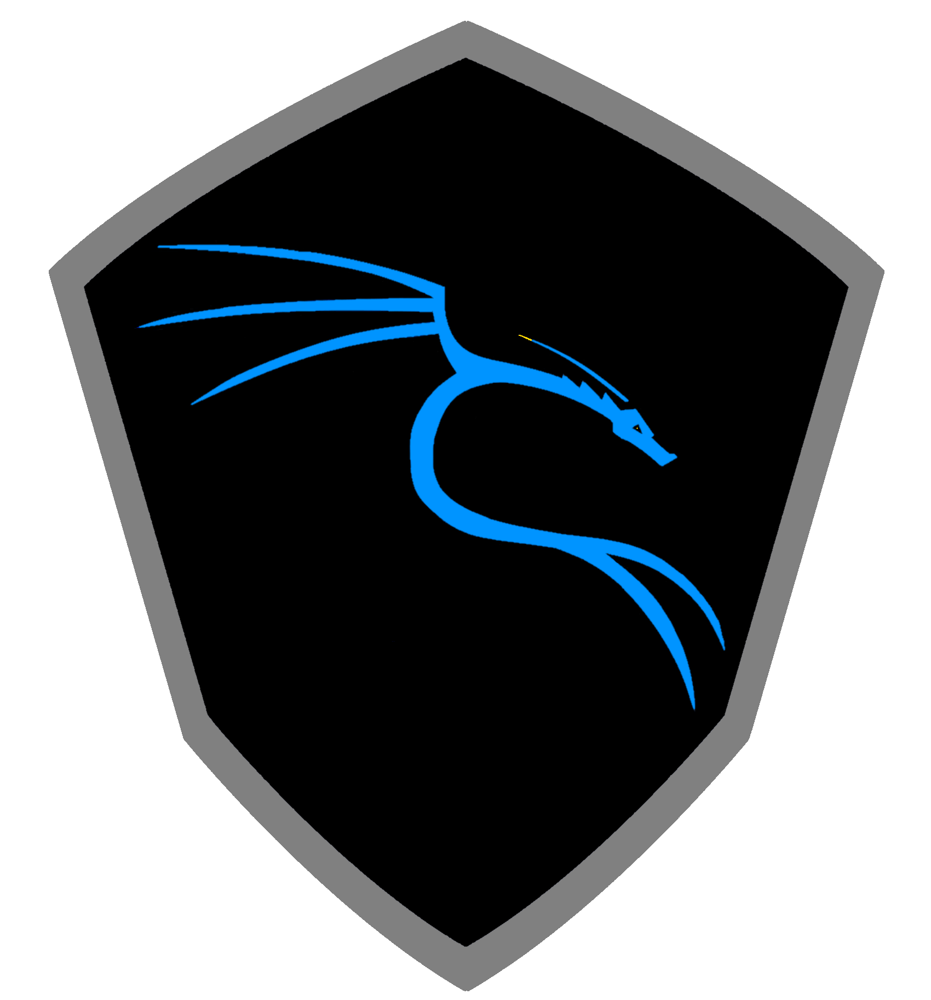
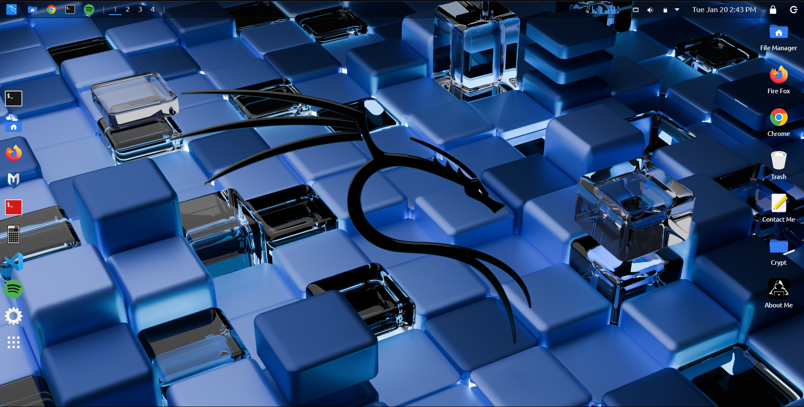

 <div align="center">



# KALI LINUX PORTFOLIO

**CYBERSECURITY · DEVELOPMENT · CREATIVITY**

A developer portfolio with a terminal-inspired interface.

<br />

<a href="https://portfolio-kali.vercel.app/">
  
</a>

<br /><br />


</div>

---

## <code>01</code> — THE EXPERIENCE

<table>
<tr>
<td bgcolor="#0d1117">

<p>
  <sub><strong>~/portfolio/preview</strong></sub>
  &nbsp; · &nbsp;
  <sub>MAIN INTERFACE</sub>
</p>



</td>
</tr>
</table>

<div align="center">

*A dark interface. A developer-first aesthetic. A portfolio built around code.*

</div>

---

## <code>02</code> — ABOUT ME

I'm a Computer Science and Data Analytics student at **IIT Patna**, passionate about programming, cybersecurity, and building useful technology.

I enjoy exploring how systems work, developing web applications, and learning about ethical hacking and software security.

My goal is to combine creative development with a security-first mindset to build practical, reliable digital experiences.

---

## <code>03</code> — BUILT WITH PURPOSE

<table>
<tr>
<td width="50%" valign="top">

**FRONTEND**

React.js and Tailwind CSS power the portfolio's component-based interface and styling.

</td>
<td width="50%" valign="top">

**CONTACT**

EmailJS integration supports contact form submissions when configured.

</td>
</tr>
</table>

---

## <code>04</code> — RUN LOCALLY

Clone the repository and install the dependencies:

```bash
git clone https://github.com/ankitkushwaha-ank/Kali
cd Kali
npm install
npm start
```

For Create React App, visit [http://localhost:3000](http://localhost:3000).

Build for production:

```bash
npm run build
```

<sub>Verify the available scripts in `package.json` before running these commands.</sub>

---

<div align="center">

### EXPLORE THE LIVE PORTFOLIO

<a href="https://portfolio-kali.vercel.app/">
  <strong>portfolio-kali.vercel.app ↗</strong>
</a>

<br /><br />

<sub>DESIGNED AROUND CODE. INSPIRED BY CYBERSECURITY.</sub>

</div>
